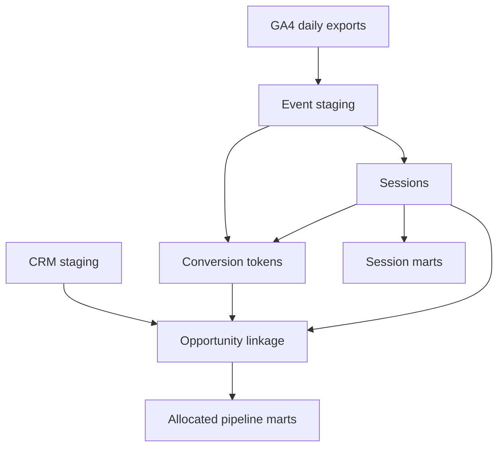

# Architecture

Raw daily GA4 tables feed parameter staging, session aggregation, and the conversion-token bridge. CRM snapshots supply deterministic opportunity paths. Session and pipeline marts expose controlled grains for downstream reporting.

## Corrections to the source PDF

The requested filenames and layers are retained. These changes repair defects in the sample SQL:

1. A session's identity includes `user_pseudo_id` and `ga_session_id`. Distinct composite IDs across all shards already avoid midnight inflation; counting by export date and summing daily distincts is what reintroduces duplication. The key itself is not the only fix.
2. Session date comes from the session ID's Unix timestamp in the configured GA4 timezone. Missing identifiers stay out of session counts and appear in an audit model.
3. Optional attribution fields are read through `TO_JSON_STRING`/`JSON_VALUE` so older schemas lacking those fields can still map to null. Incompatible wildcard column types must still be normalized upstream; JSON does not repair wildcard schema mismatches.
4. A complete source/medium/campaign struct is selected together. Cross-channel session attribution precedes Google Ads, manual session attribution, gclid fallback, then collected traffic. Lifetime fields are retained only for inspection.
5. `SAFE_CAST`, numeric fallbacks, and stable first-offset selection prevent malformed or repeated parameters from crashing scalar extraction. Integer extraction accepts integral float values; fractional numeric IDs become null. Empty parameter arrays are valid.
6. Session engagement uses the exported `session_engaged` flag. A `user_engagement` event alone is not treated as the official engaged-session flag.
7. All conversion tokens are preserved in a separate session-token bridge. Selecting only the first token loses later leads from the same session.
8. CRM linkage uses explicit IDs and tokens, never an `email OR token` full join. Multiple evidence paths are ranked and collapsed to one opportunity/session row. ConvertedOpportunityId works without Opportunity.ContactId.
9. Opportunities drive the left join. Unmatched rows receive an explicit Unattributed allocation, avoiding missing revenue and divide-by-zero.
10. First-observed weighting selects exactly one session per opportunity, including timestamp ties. Linear weights sum to one. Dedicated allocated measures prevent raw opportunity values from being mistaken for additive revenue.
11. ARR remains a separate nullable field. Amount fallback is labeled with `revenue_basis`; currency remains visible. An opportunity's Amount is not silently renamed ARR.

## Refresh and attribution policy

v1 rebuilds session and attribution tables on every run. It scans a configurable daily export range, making late arrivals and CRM corrections visible on the next rebuild within that range. This avoids incremental partition boundary and deleted-source-row hazards while keeping the v1 model inspectable. Size and measure the window before adopting an incremental strategy.

A token joins only where both session start and recorded token timestamp precede or equal opportunity creation. The session must start within the configured attribution lookback. This models pre-creation pipeline influence. It deliberately excludes post-creation expansion and does not produce bookings by close date.

Current CRM snapshots are required. Duplicate IDs fail tests; they are not arbitrarily suppressed. Source uniqueness tests are part of the release gate: `dbt build` is a validation command, not an atomic promotion system. Do not promote partially built marts after a failure.

A token reused across distinct users fails a singular test. A token connected to multiple opportunities may be legitimate repeat business; each opportunity conserves its own value and is inspected independently.

## Reference contracts

- [GA4 BigQuery export schema](https://support.google.com/analytics/answer/7029846): export fields and scope.
- [GA4 traffic attribution data](https://developers.google.com/analytics/bigquery/traffic-attribution-data): session-scoped last-click fields.
- [dbt BigQuery configurations](https://docs.getdbt.com/reference/resource-configs/bigquery-configs): partitioned and clustered table materializations.
